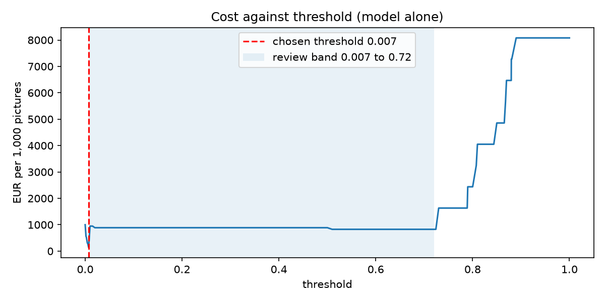

# Assignment 2 Report

- **Name**: Sarah Coste
- **Student ID**: 19863
- **Email**: scoste.ieu2022@student.ie.edu
- **Group**: BBADBA 5B

## Business problem, and the cost of being wrong

The setting is a broiler farm: thousands of chickens living together, cooped up in the same barn. In those conditions, one sick chicken is a real risk. If a chicken is sick, there’s a high chance the disease spreads to other chickens, and if it goes untreated, it can kill many of them. That’s the worst case, but it can happen, and it’s what we’re trying to avoid.

The model looks at camera images of the barn and decides whether a chicken in the image looks sick. When it flags one, a farm worker goes to find the chicken, checks it, and removes it if it’s sick. Today, sick birds are found by a worker walking through the barn once a day.

The model can be wrong in two ways:

False positive (false alarm): the model flags a healthy chicken. The worker spends about 5 minutes finding, catching and checking it for nothing. At about €12.50/hour (Spanish minimum wage plus employer social security), that’s about €1.
False negative (miss): the model doesn’t flag a sick chicken. The bird is lost (about €4), and the disease can spread. I estimated an outbreak at about €8,000 (around 2,000 birds lost). I assumed a 5% chance that one missed bird causes an outbreak, because a missed bird is usually found on the next daily walk anyway, so a miss really means one extra day of possible spreading. That puts a miss at about €4 + 5% × €8,000 = €404.

So a miss costs about 400 times more than a false alarm. That’s why I’d rather have the model flag too many chickens than too few. But checking every chicken isn’t realistic either, so we have to find a trade-off between checking on too many chickens and not checking on enough of them.

What this means for the rest of the report:

- The number I care about most is recall on sick chickens, so how many of the sick ones the model actually catches. Since a miss is way more expensive, catching sick chickens matters more than avoiding false alarms.
- I expect the threshold to be pretty low, because I want the model to flag a chicken even when it's not super sure. But the actual number comes from the cost sweep, not from my gut.
- When the model isn't sure, a worker first looks at the picture on a screen for a few seconds before walking over. That saves walks without missing sick chickens. How many pictures go to review depends on how many hours the workers actually have.

## Dataset

- Roboflow Universe: workspace annotate-8nzza, project chicken-sick-healthy, version 9
- Link: https://universe.roboflow.com/annotate-8nzza/chicken-sick-healthy/dataset/9
- Task: object detection, 2 classes: diseased-chicken, healthy-chicken
- Size: 2,047 images in version 9, made from 571 original images (the rest are augmented copies)
- One image = a photo with one or more chickens, each with a box saying sick or healthy.

The dataset has exactly the two classes my decision needs, sick vs healthy chickens, with boxes around each bird. So the model can say whether there’s a sick chicken in an image, which is the call the worker acts on.

A lot of the images aren’t from a barn camera. Some are internet photos: a baby chick held in someone’s hand, close-ups of a single chicken’s head, even a screenshot with text on it. A real barn camera would show many birds from above, in dim light, often partly hidden. So the model’s test score will probably look better than how it would actually perform on a farm.

## What the dataset's composition implies

| Split | Images | Images with a sick bird | Sick boxes | Healthy boxes |
|---|---|---|---|---|
| Train | 1,968 | 1,312 | 2,313 | 3,889 |
| Valid | 53 | 33 | 61 | 85 |
| Test | 26 | 10 | 15 | 47 |

On average, a sick chicken’s box takes up about 28% of the image, while a healthy one only takes about 4%.

What this means:
1. The test set is way too small to really trust. There are only 26 test images, and only 10 have a sick bird in them (15 sick boxes in total). So every single sick image the model gets right or wrong moves the recall by 10 points. My test numbers are more of a rough idea than a real measurement.
2. The training set is smaller than it looks. The 1,968 training images actually come from about 492 original photos, each copied 4 times with flips and rotations. So really, the model has only seen around 490 different photos.
3. Sick chickens are photographed way closer than healthy ones. The sick birds are mostly close-ups, while the healthy ones are mostly small chickens in flock photos. So the model might just learn “big close-up chicken = sick” instead of actually learning what a sick chicken looks like. A barn camera would see lots of small chickens from far away, so that shortcut wouldn’t work on a real farm.
4. The test set has way more sick birds than a real farm would. 10 out of 26 test images (38%) have a sick bird, while on a farm I’m assuming it’s more like 2%. That’s why I use the 2% base rate in my cost calculations instead of the test set’s mix.
5. The images don’t really look like a barn camera. Some of them are just internet photos: a baby chick in someone’s hand, a close-up of one chicken’s head, even a screenshot with text on it. So the test set doesn’t really represent what the model would see in real life.
6. The classes aren't balanced. There are about 1.7 times more healthy boxes than sick ones in training (3,889 vs 2,313), and in the test set it's even worse: 47 healthy vs only 15 sick. So the model gets more practice on healthy chickens, and the sick class, the one I actually care about, is the one with the least data to test on.

So I can’t conclude wether this model would actually work on a real farm camera. The most I can say is that it can tell sick from healthy chickens in photos like these.

## Finetuning and baselines

I used object detection with yolo11n, which is YOLO version 11, the smallest one.

Why detection? n a barn, one picture has a bunch of chickens in it. Detection puts a box around each one, so the worker knows exactly which chicken to go check. Plus the dataset is already labelled with boxes, so it just made sense.

Why yolo11n? It's the smallest and fastest version. It could run on a cheap little computer next to the camera on a real farm. yolo11s might be a bit more accurate, but I didn't think it was worth it.

Settings: trained on my MacBook (Apple M2 Pro) for 30 epochs, which took about 53 minutes, with 640×640 images, starting from the COCO-pretrained weights.

I compared three models on the same 26 test pictures, asking each one "is there a sick chicken in this picture?":

- My finetuned model
- The COCO model zero-shot, which is the original YOLO, never trained on my chickens. It doesn't know what "sick" is, so I just counted any bird it found as an alarm.
- A trivial baseline that always says "no sick chicken", because that's the most common answer.

| Model | Precision (sick) | Recall (sick) | Accuracy | Cheapest cost per 1,000 pictures |
|---|---|---|---|---|
| My finetuned model | 0.90 | 0.90 | 0.92 | €142.50 |
| COCO zero-shot | 0.56 | 0.90 | 0.69 | €816 |
| Trivial (always "no sick chicken") | 0 | 0 | 0.62 | €1,000 |

Precision, recall and accuracy are at a 0.5 threshold. The last column is each model at its own cheapest threshold.

What I expected: the trivial one never catches a sick chicken, the COCO one flags basically every picture with a chicken in it, and mine beats both.

What actually happened: pretty much that. The trivial one never catches anything. The COCO one does catch sick chickens, but only because it flags almost every picture with a bird in it. At its cheapest threshold, it flags 13 of the 16 healthy pictures too. Mine catches the same number of sick chickens with almost no false alarms, and it's about 6 times cheaper than COCO. The gap on cost was bigger than I expected. But with only 10 sick test pictures, one picture more or less could change these numbers a lot.

## Per-class evaluation and failure modes

Positive class: diseased-chicken.

| Class | Precision | Recall | AP50 | AP50-95 |
|---|---|---|---|---|
| diseased-chicken | 0.73 | 1.00 | 0.89 | 0.52 |
| healthy-chicken | 0.82 | 0.67 | 0.77 | 0.41 |
| Overall | | | mAP50 0.83 | mAP50-95 0.47 |

The sick class carries the headline number. It found all 13 sick chicken boxes in the test pictures, but about 1 in 4 of its "sick" boxes was wrong. The healthy class is the one dragging, since it misses about a third of the healthy chickens. That's probably the small chickens in flock photos, which makes sense because healthy chickens are tiny in this dataset (about 4% of the picture). For my decision that matters less, because I only act on sick chickens.

Confusion matrix per picture (threshold 0.5):

| | Model says sick | Model says healthy |
|---|---|---|
| Actually sick | 9 | 1 |
| Actually healthy | 1 | 15 |

These numbers are per picture, while the table above is per box, so they're not exactly the same thing. Per picture, the model does miss one sick picture at 0.5.

Where it breaks:

- The one sick picture it missed is a stock photo (from iStock), and it only gave it a score of 0.007. So it struggles with pictures that look different from the rest, which is a bad sign for a real barn camera.
- One healthy picture scored 0.50, right on the edge, so it would flip between false alarm and not depending on the threshold.
- On the validation pictures, sick recall was 0.80, not 1.00. So the perfect test result is probably partly luck from the small test set.
- Some test pictures are frames from the same videos (their names have "mp4" in them), so similar frames could also be in training, which would make the results look better than they really are.
- One test picture was skipped when measuring the boxes because its label file was broken, so the box numbers are on 25 pictures, not 26.

## Cost matrix and operating point

The costs:

- False alarm: €1. A healthy chicken gets flagged, so a worker spends about 5 minutes finding it, catching it and checking it for nothing. Workers would earn around €12.50 an hour (Spain's 2026 minimum wage is €1,221 × 14 payments, plus the employer's social security), so 5 minutes is about €1.
- Miss: €404. A sick chicken doesn't get flagged. The chicken is lost (about €4, since chicken sells for about €2.34 per kg and a broiler gives about 1.8 kg), and the disease might spread. I estimated an outbreak at about €8,000 (around 2,000 chickens lost), and I assumed a 5% chance that one missed chicken causes one, because the worker would probably find it on his daily walk anyway. So €4 + 5% × €8,000 = €404.
- Correct alarm: €1. Same 5-minute check, but the chicken really is sick.
- Review: €0.07. A worker looks at a flagged picture on a screen for about 20 seconds.

Base rate: I assumed 2% of camera pictures have a sick chicken in them. Broiler farms lose a few percent of their chickens over a whole cycle, so on any given day only about 1 in 1,000 chickens is sick. But each picture shows about 20 chickens, so about 20 in 1,000 pictures, so 2%, would have a sick one.

The sweep: I tried every threshold from 0 to 1 and calculated the cost per 1,000 pictures for each one, re-weighted to my 2% base rate, since the test set has way more sick chickens than a real farm. With the model deciding alone, the cheapest threshold is 0.007, at €142.50 per 1,000 pictures. That's just below the score of the least suspicious sick picture, so it catches all of them. Above 0.007 the cost jumps to around €830–950, because that sick picture gets missed, and above 0.72 it keeps climbing until it reaches €8,080, which is the same as doing nothing.

My operating point: low 0.007, high 0.72, with a review band in between. That costs €28.72 per 1,000 pictures. I chose it because missing a sick chicken costs way more than reviewing a picture, so I'd rather send more pictures to a person.

How much the costs matter: I know the gap between a miss and a false alarm is huge, so I checked how much it changes things. My threshold stays at 0.007 as long as a miss costs at least about €62, so as long as the chance of an outbreak is above about 0.7%. It would only switch to a higher threshold if a miss cost almost nothing (like just losing the bird), or if a false alarm cost more than about €6.60. And since my setting doesn't miss any sick chicken on the test pictures, its cost stays at €28.72 whether the outbreak chance is 1% or 25%.

The assumption that would change my answer the most: that real barn pictures score like my test pictures. The 0.007 was basically set by one single stock photo, so if lots of healthy barn pictures score just above 0.007, a lot more pictures would go to review.

Sources:
- Spanish minimum wage 2026 (€1,221 a month, €17,094 a year): https://www.legaltoday.com/actualidad-juridica/noticias-de-derecho/el-boe-publica-el-smi-para-2026-que-se-establece-en-1-221-euros-sin-tributacion-2026-02-19/
- Employer social security in Spain 2026 (30.65%): https://www.sage.com/es-es/blog/cotizaciones-a-la-seguridad-social-conceptos-bases-y-porcentajes/
- Chicken price in Spain (€2.34 per kg of carcass): https://www.agronewscastillayleon.com/produccion-carne-pollo-espana-2026-mapa-consumo-precios
- Broiler mortality (3.96% of broilers died on farm in 2021, Scotland): https://www.foodstandards.gov.scot/freedom-of-information/total-percentage-of-on-farm-broiler-chicken-mortalities-in-2021

## What a person still has to check

My two thresholds are 0.007 and 0.72:
- Below 0.007: pass, nothing happens.
- Between 0.007 and 0.72: a worker looks at the picture on a screen first.
- Above 0.72: a worker goes straight to the chicken.

That sends about 12.4% of pictures to a person. With 2,000 pictures a day (about 14 cameras taking a photo every 10 minutes), that's around 249 pictures a day. At about 20 seconds each, that's about 1.4 hours a day, so 0.7 people if each worker spends 2 hours a day on it next to their normal barn work.

On top of that, about 1.8% of pictures go straight to "go check the chicken", so about 36 walks a day. At 5 minutes each, that's about 3 hours. So in total it's about 4.4 hours of work a day, roughly half a shift for one worker.

Is that realistic? Yes, one worker can handle that. But it only holds if real barn pictures behave like my test pictures. If the review share went up to 40%, that would be about 800 pictures and 4.4 hours a day just for the screen checks, so more than 2 people, which would start to be a problem.

Compared with the alternatives (cost per 1,000 pictures):

| Option | Cost per 1,000 pictures | Workload |
|---|---|---|
| Do nothing | €8,080 | none, but every sick chicken gets missed |
| A person checks every picture | €90 | 2,000 pictures × 20 seconds = 11 hours a day, so about 5.5 people |
| Model decides alone (threshold 0.007) | €142.50 | about 285 walks a day × 5 minutes = about 24 hours of walking, so 3 full-time workers |
| Model + review band (0.007 to 0.72) | €28.72 | about 4.4 hours a day, so about half of one worker |

So the model with a review band is the cheapest option, and it's the only one that's also realistic for the workers. Checking everything by hand looks cheap in euros, but nobody has 11 hours a day to stare at pictures. And the model on its own sends workers on way too many walks, because at 0.007 it flags a lot of healthy pictures. The review band fixes that: a 20-second look on a screen filters out most of those before anyone walks over.

## Limitations & next steps

- The test set is really small. Only 10 test images actually have a sick chicken in them (and one test picture got skipped because its label file was broken), so honestly my results could easily be off. If I had more time, I'd test on a way bigger set, like at least 100 images with sick chickens.

- I picked my thresholds using the same test pictures I report my results on. And the 0.007 was basically set by one single stock photo of a sick chicken. So my €28.72 per 1,000 pictures is probably too good to be true. To fix it, I'd pick the thresholds on one set of pictures and then check the cost on a completely different set.

- I think the model might be learning "close-up = sick". In this dataset, the sick chickens are mostly close-ups and the healthy ones are mostly small chickens in a flock. So it might be picking up on how close the photo is instead of what a sick chicken actually looks like. To fix it, I'd look at the mistakes it makes on close-ups of healthy chickens and add more of those to the training.

- The photos aren't from a barn camera. A lot of them are just random internet pictures. Before using this on a real farm, I'd want to collect and label a few hundred images from the actual barn camera and test on those.

- Some test pictures are frames from videos (their file names have "mp4" in them), so their almost-twins from the same video could be in the training set. That would make my results look better than they really are. I'd check the test images for near-duplicates, or re-split them so frames from the same video stay together.

- The validation set is small too, only 53 images. The training uses it to pick the "best" model, so that choice is kind of random. You can see it in the numbers: sick recall was 0.80 on validation but 1.00 on test. I'd use a bigger validation set, or train it a few times and check the results stay about the same.

- My costs are estimates. The weakest ones are the €8,000 for an outbreak (I couldn't find a real number for broiler farms, so I assumed about 2,000 chickens lost) and the 5% chance that a missed chicken causes one. I'd ask an actual farmer or vet for real numbers, like how often a missed chicken actually leads to more sick chickens. The good thing is my threshold doesn't change unless a miss drops below about €62.

- I assumed the person reviewing the images never makes a mistake. In real life they'd obviously miss some sick chickens too. I'd measure how often a reviewer actually gets it right and add that to the cost.

- "Diseased" kind of lumps every illness together. The dataset doesn't say if a chicken has something contagious or if it's just weak or hurt, but that's literally what decides how bad a miss is. I'd want a dataset labelled by type of illness, so the contagious cases can cost more than the others.

- One picture is just a snapshot. From what I understand, farmers often notice sick chickens by how they act over time, like not moving or not eating, and one photo can't show that. I'd use short videos instead, or a few photos of the same spot over a couple of minutes.

- My COCO baseline is pretty basic. The original YOLO doesn't know what "sick" means, so I just counted any bird it found as an alarm. It works as a dumb comparison, but it's not a strong one. I'd also compare against a simple classification model trained on the same pictures, to see if detection was actually worth it.

## Generative AI use disclosure

I acknowledge the use of Claude (Anthropic) as an AI-assisted tool during the development of this work. It was used to support code development, particularly in building code, understanding code syntax, identifying and correcting errors, and improving the functionality of code. Additionally, AI was used to assist with proofreading and editing written content, including correcting grammatical errors, refining sentence structure, and improving the overall clarity, coherence, and flow of the writing. All AI-assisted outputs were reviewed and adapted as necessary, and I take responsibility for the final submitted work.